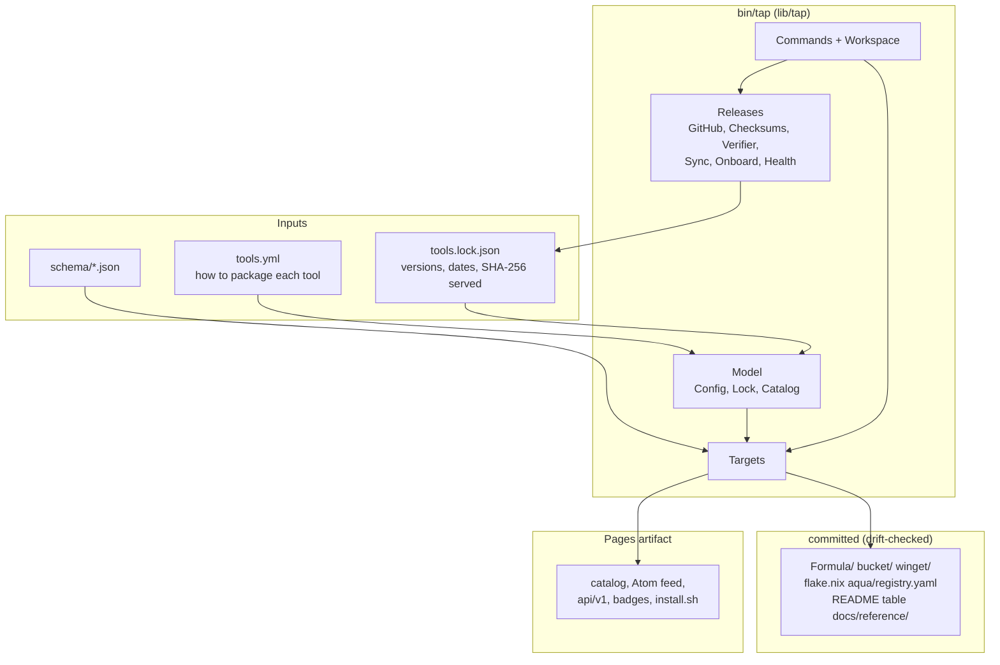

# Architecture

## Files

| Path | Role | Written by |
| --- | --- | --- |
| `tools.yml` | One entry per tool: repository, archives, binaries, verification level, names per package manager | the owner, or `bin/tap add` / `rollback` / `unpin` |
| `tools.lock.json` | Tag, version, publication date and SHA-256 of every archive served | `bin/tap sync` |
| `schema/tools.schema.json` | `tools.yml` for editors; `test/schema_test.rb` keeps it in step with `config.rb` | the owner |
| `schema/api.schema.json` | The public API; served as `/api/v1/schema.json`, tested against the output | the owner |
| `Formula/`, `bucket/`, `winget/manifests/`, `flake.nix`, `aqua/registry.yaml` | What each package manager reads | `bin/tap render` |
| `README.md` | Hand-written, except between the `GENERATED: tools` markers | both |
| `docs/reference/` | Generated from the schemas and the CLI | `bin/tap render` |
| `templates/` | Formula, flake and site templates (ERB) | the owner |
| `formula_renames.json`, `tap_migrations.json` | Old names (`addlicense`, the old cask) to `gregoiref-addlicense` | the owner |
| `flake.lock` | nixpkgs pin, Nix's own file | `nix flake lock` |
| `test/` | Minitest suite, golden files, `installer.sh` and `aqua.sh` end-to-end scripts | the owner |
| `.githooks/` | `pre-commit` (rake), `commit-msg` (header format, no co-author) | the owner |

## The generator (`lib/tap/`)

| Layer | Files | Does |
| --- | --- | --- |
| Model | `config.rb`, `lock.rb`, `catalog.rb` | `tools.yml` validated (including `brew audit`'s desc rules), the lock, and the `Catalog` every target reads |
| Releases | `github.rb`, `checksums.rb`, `verifier.rb`, `sync.rb`, `onboard.rb`, `health.rb`, `commit_lint.rb` | GitHub API (the token goes to the API host only); sha256sum files; `gh attestation verify`; download, hash, cross-check, verify, refuse downgrades unless pinned; entries inferred from a release; nightly findings; the commit header rules |
| Targets | `targets.rb`, `targets/*.rb` | One module per output with `files(catalog)` and `GLOBS` ([ADR-0006](docs/adr/0006-targets-as-plugins.md)) |
| Commands | `workspace.rb`, `commands.rb`, `commands/*.rb`, `cli.rb` | One class per `bin/tap` command, sharing a `Workspace` (files in binary mode, GitHub, `$GITHUB_OUTPUT`) |

| Target | Kind | Output |
| --- | --- | --- |
| `Homebrew` | repository | `Formula/<formula>.rb`: archives per platform, livecheck, completions, `conflicts_with`, version test |
| `Scoop` | repository | `bucket/<tool>.json` |
| `Winget` | repository | `winget/manifests/…/<version>/` (1.10.0, portable zip) |
| `Nix` | repository | `flake.nix`, one package per tool and system |
| `Aqua` | repository | `aqua/registry.yaml`, templated on the version |
| `Readme` | repository | the tools table of `README.md` |
| `Docs` | repository | `docs/reference/*.md` |
| `Pages` | site | catalog pages, Atom feed |
| `Api` | site | `api/v1/tools.json`, `api/v1/tools/<tool>.json`, schema |
| `Badges` | site | shields.io endpoints per tool |
| `Installer` | site | `install.sh` |

Targets are pure, so `bin/tap check` (run by `rake` and CI) fails as soon as
a committed file differs from what the generator writes or a stray one is
left under a target's `GLOBS`.

## Workflows

| Workflow | When | Does |
| --- | --- | --- |
| `sync.yml` | every 30 min, manual (`rollback` input) | discover → verify → install test → signed commit → provenance of the published files → site → WinGet submission |
| `install-test.yml` | nightly, called by sync | brew on 5 runners, install.sh on 2 (+ Alpine), Nix on 2, aqua on 2, Scoop and `winget validate` on 2; health; one issue per problem kind |
| `pages.yml` | called by sync, daily, push | `bin/tap site` with the last install-test result → GitHub Pages |
| `ci.yml` | push, pull request | tests and coverage, drift, `brew test-bot --only-tap-syntax`, license headers, commit header, actionlint, zizmor, shellcheck, Dependabot automerge |
| `secrets.yml` | monthly | WINGET_TOKEN expiry and CI signing key age; issue when due |
| `codeql.yml` | weekly, push, pull request | CodeQL for Ruby and Actions |
| `scorecard.yml` | weekly, push | OpenSSF Scorecard |

Every job starts with harden-runner (egress audit) on Linux, pins actions by
commit at versions at least 7 days old, and declares its own permissions.

## Secrets and environments

| Environment | Secret | Used by | Without it |
| --- | --- | --- | --- |
| `publish` | `TAP_SIGNING_KEY` (SSH, signing only) | sync's publish job | publish fails loudly |
| `winget` | `WINGET_TOKEN` (PAT, `public_repo`) | sync's winget job, secrets.yml | submission skipped with a notice |
| `github-pages` | none | pages.yml | |

Repository settings, the `main-integrity` ruleset and the `publish`
environment are declared in [GregoireF/iac](https://github.com/GregoireF/iac)
(`terraform/github/tap.tf`).

## Decisions

[`docs/adr/`](docs/adr/).
