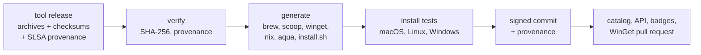

# GregoireF/homebrew-tap

[](https://github.com/GregoireF/homebrew-tap/actions/workflows/ci.yml)
[](https://github.com/GregoireF/homebrew-tap/actions/workflows/install-test.yml)
[](https://scorecard.dev/viewer/?uri=github.com/GregoireF/homebrew-tap)

The command-line tools of [GregoireF](https://github.com/GregoireF) for
Homebrew, Scoop, WinGet, Nix, aqua and a plain `install.sh`, from one
repository. Every version here had its archives checked against their
checksums and signed build provenance, and was installed and run on macOS,
Linux and Windows, before it was published.

**Catalog:** [gregoiref.github.io/homebrew-tap](https://gregoiref.github.io/homebrew-tap/) ·
[Atom feed](https://gregoiref.github.io/homebrew-tap/feed.xml) ·
[JSON API](https://gregoiref.github.io/homebrew-tap/api/v1/tools.json)

## Tools

<!-- BEGIN GENERATED: tools -->

| Tool | Description | Version | Homebrew | Scoop | Verified with |
| --- | --- | --- | --- | --- | --- |
| [`addlicense`](https://github.com/GregoireF/addlicense) | Fast, minimal license header manager for monorepos and CI pipelines | [1.0.1](https://github.com/GregoireF/addlicense/releases/tag/v1.0.1) | `brew install gregoiref/tap/gregoiref-addlicense` | `scoop install gregoiref/addlicense` | SHA-256 |
| [`kiwa`](https://github.com/GregoireF/kiwa) | Find any project, run any task: workspace launcher for humans and AI agents | [0.1.0](https://github.com/GregoireF/kiwa/releases/tag/v0.1.0) | `brew install gregoiref/tap/kiwa` | `scoop install gregoiref/kiwa` | SLSA provenance |
| [`ship`](https://github.com/GregoireF/ship-it) | You write the code, ship handles git and GitHub | [0.1.2](https://github.com/GregoireF/ship-it/releases/tag/v0.1.2) | `brew install gregoiref/tap/ship` | `scoop install gregoiref/ship` | SLSA provenance |

<!-- END GENERATED: tools -->

## Install

| | |
| --- | --- |
| **Homebrew** (macOS, Linux) | `brew install gregoiref/tap/<formula>` |
| **Scoop** (Windows) | `scoop bucket add gregoiref https://github.com/GregoireF/homebrew-tap` then `scoop install gregoiref/<tool>` |
| **WinGet** (Windows) | `winget install --id GregoireF.<tool> --exact`, once winget-pkgs has merged the version |
| **Nix** | `nix run github:GregoireF/homebrew-tap#<tool>` |
| **aqua** | the [registry](aqua/registry.yaml): see [package managers](docs/explanation/package-managers.md#aqua) |
| **mise** | `mise use github:GregoireF/<repository>` |
| **No package manager** (macOS, Linux) | `curl -fsSL https://gregoiref.github.io/homebrew-tap/install.sh \| sh -s -- <tool>` |

Homebrew 6 and later load a non-official tap only once trusted. Installing
by full name trusts that formula; for short names or a `Brewfile`:

```sh
brew tap gregoiref/tap && brew trust --formula gregoiref/tap/kiwa && brew install kiwa
```

```ruby
tap "gregoiref/tap", trusted: { formulae: ["kiwa", "ship"] }
brew "gregoiref/tap/kiwa"
```

New here? [Install your first tool](docs/tutorials/install-your-first-tool.md)
walks through it, checks included.

> **addlicense** is `gregoiref-addlicense` in Homebrew: homebrew-core's
> `addlicense` is [google/addlicense](https://github.com/google/addlicense),
> another tool ([why](docs/adr/0007-gregoiref-addlicense.md)). The old name
> still resolves. If you had the old cask:
> `brew uninstall --cask addlicense && brew install gregoiref/tap/gregoiref-addlicense`.

## Verify

```sh
gh attestation verify ship_0.1.2_linux_amd64.tar.gz --repo GregoireF/ship-it   # the archive
gh attestation verify Formula/ship.rb --repo GregoireF/homebrew-tap             # the formula
```

More in [Verify a download](docs/how-to/verify-a-download.md) and the
[security model](docs/explanation/security-model.md).

## How it works

Nobody edits what this repository serves. [`tools.yml`](tools.yml) says how
to package each tool; every 30 minutes `sync.yml` looks for new stable
releases, verifies them, writes every package manager's files, installs
them on 13 runners, then commits them, signed, straight to `main`.



Nightly, every published version is reinstalled and its provenance checked
again; a problem opens an issue that closes itself once fixed. A tool joins
by getting the `gregoiref-tap` topic. Details:
[how publishing works](docs/explanation/how-publishing-works.md),
[ARCHITECTURE.md](ARCHITECTURE.md), [ROADMAP.md](ROADMAP.md), and the rest of
the [documentation](docs/).

An install problem? [Open an issue](https://github.com/GregoireF/homebrew-tap/issues/new/choose).
A bug in a tool itself belongs to that tool's repository.

## License

The packaging files here are available under the [MIT](LICENSE-MIT) or
[Apache-2.0](LICENSE-APACHE) license, at your option. Each tool has its own
license, listed in its formula and in the [API](docs/reference/api.md).
