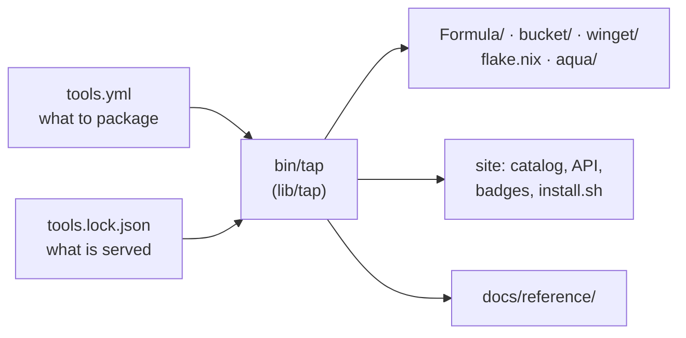

# Documentation

Organised with [Diátaxis](https://diataxis.fr): pick the column that fits
what you are doing.

| Learn | Do | Understand | Look up |
| --- | --- | --- | --- |
| [Install your first tool](tutorials/install-your-first-tool.md) | [Add a tool](how-to/add-a-tool.md) | [How publishing works](explanation/how-publishing-works.md) | [`tools.yml` keys](reference/tools-yml.md) |
| | [Roll back a release](how-to/roll-back-a-release.md) | [Security model](explanation/security-model.md) | [API v1](reference/api.md) |
| | [Verify a download](how-to/verify-a-download.md) | [Package managers](explanation/package-managers.md) | [`bin/tap`](reference/cli.md) |
| | [Work on the tap](how-to/work-on-the-tap.md) | [Architecture](../ARCHITECTURE.md) | [Decisions (ADRs)](adr/) |
| | [Rotate the secrets](how-to/rotate-secrets.md) | | |

The pages under `reference/` are generated by `bin/tap render` from the
schemas and the CLI; edit their source, not the page. New pages start from
[`templates/`](templates/).

