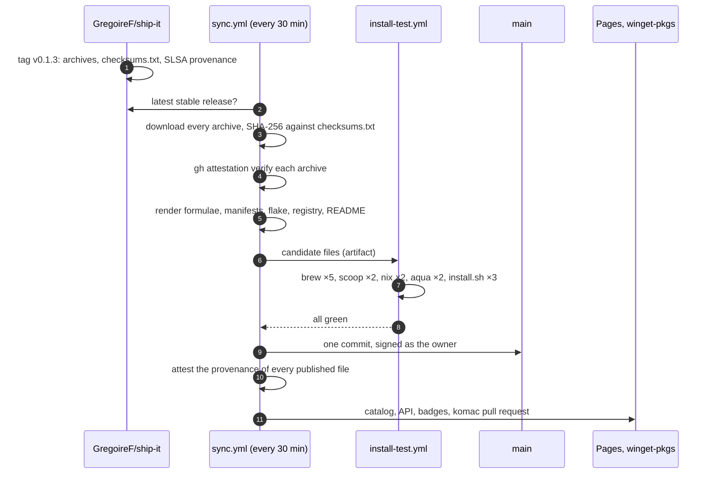

# How publishing works

The owner tags a release in a tool's repository. Everything after that
happens in this repository, without a person in the loop and without a pull
request. This page follows one release, `ship 0.1.3`, through the pipeline.

## Why the tap pulls

The producers hold no token that can write here: a leaked release secret
in one tool's repository cannot change what users install
([ADR-0001](../adr/0001-tap-pulls-releases.md)). Polling costs at most 30
minutes of delay.

## Why not `brew bump`

Homebrew's own autobump opens one pull request per version from livecheck
and leaves verification to the reviewer. Here nothing is reviewed by hand,
so verification is in the pipeline instead: provenance, real installs on
every platform, and a signed commit
([ADR-0005](../adr/0005-sync-not-brew-bump.md)). The formulae still carry a
`livecheck` block, so `brew livecheck gregoiref/tap/ship` works.

## What stops a release

| Check | Stops when |
| --- | --- |
| Checksums | An archive's SHA-256 differs from `checksums.txt` |
| Provenance | A `verify: attestation` tool's archive has no valid SLSA provenance from its repository |
| Downgrade | The "latest" release is older than the one served (unless `pin`ned) |
| `bin/tap check` | A generated file differs from what the generator writes |
| Install tests | One install or run fails on any runner |
| Ruleset | The commit is not signed |

A stopped release is not published: the files on `main` stay as they were,
the sync run is red, and the next run tries again.

## After publishing

- The nightly **install-test** reinstalls everything from `main`; a failure
  opens the issue *Nightly install test failing*.
- The nightly **health** check opens *Tap health report* for stale tools,
  lost provenance, pinned tools, or a checksum-only tool that could now be
  verified.
- The monthly **secrets** check opens *Secret rotation due*.

Each issue closes itself once the problem is gone.
