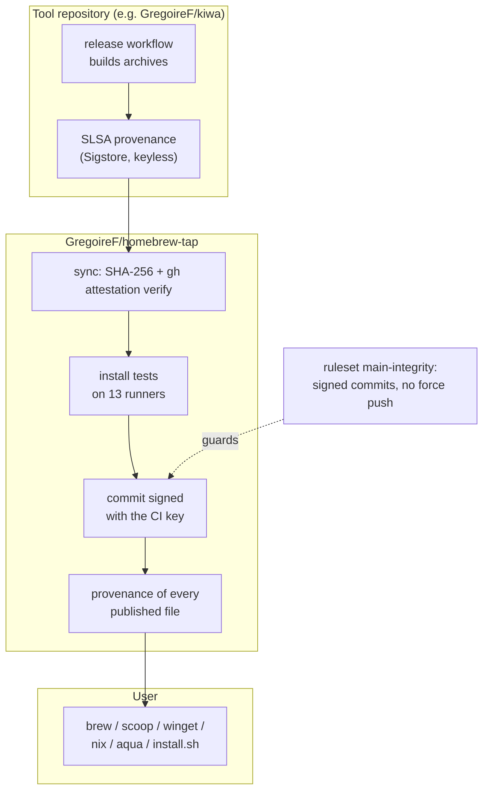

# Security model

What the tap protects users against, and what it does not.

## Threats and answers

| Threat | Answer |
| --- | --- |
| A release archive replaced after it was published | Its SHA-256 is pinned in the lock and in every manifest; the formula refuses other bytes |
| An archive built outside the tool's CI | `verify: attestation` tools need a provenance signed by their own repository's workflow |
| A producer's release token stolen | It cannot write to the tap: the tap pulls ([ADR-0001](../adr/0001-tap-pulls-releases.md)) |
| A formula edited by hand on `main` | Unsigned or not from `sync.yml`: the ruleset refuses unsigned commits, and published files carry sync's provenance |
| A compromised GitHub Action | Actions pinned by commit, at versions at least 7 days old; Dependabot with a 7-day cooldown; harden-runner records every connection |
| A new version that breaks installs | Install tests on every platform before publishing; `bin/tap rollback` afterwards |
| A secret that expires silently | Monthly check, issue 30 days ahead ([rotate](../how-to/rotate-secrets.md)) |

## What it does not do

- It does not review a tool's source: provenance proves *where* an archive
  was built, not that the code is safe.
- macOS binaries are not notarized; formulae install them without
  Gatekeeper quarantine, as Homebrew formulae do.
- `verify: checksum` tools (addlicense until its next release) are only
  checked against their release's checksums file.
- `install.sh` checks provenance only when the GitHub CLI is logged in,
  unless `--require-provenance` is given.

## Secrets

Two, each in its own environment, read only by the job that needs it:
`TAP_SIGNING_KEY` (environment `publish`) and `WINGET_TOKEN` (environment
`winget`). Secret scanning and push protection are on. Report a
vulnerability privately: [SECURITY.md](../../SECURITY.md).
