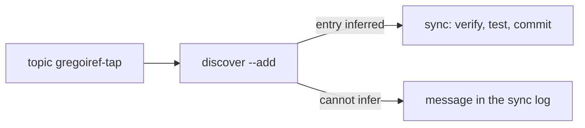

# Add a tool

Bring a new GregoireF tool into every package manager of the tap. Its
repository needs **no secret and no job** for it.

## What the tool's releases need

- **Stable GitHub releases** (drafts and pre-releases are ignored).
- One archive per platform: macOS and Linux (x86_64, arm64) as `.tar.gz` or
  `.tar.xz`, Windows (x64, arm64) as `.zip`. Binaries at the top of the
  archive, or in one directory named after it (`nested: true`, cargo-dist).
- A checksums file in sha256sum format: `checksums.txt` (GoReleaser),
  `sha256.sum` (cargo-dist).
- Ideally, a SLSA build provenance for every archive:
  `actions/attest-build-provenance` with `subject-checksums`, or
  `github-attestations = true` in cargo-dist. Without one the tool stays at
  `verify: checksum`, and the health report says when it can move up.

## The automatic way

Add the topic **`gregoiref-tap`** to the repository:

```sh
gh repo edit GregoireF/<repo> --add-topic gregoiref-tap
```

Within 30 minutes, sync runs `bin/tap discover --add`: it infers the entry
from the latest release (archives per platform, checksums file, binary,
licence, verification level, WinGet id), then verifies, install-tests and
publishes it like any version. A repository whose entry cannot be inferred
is skipped with a message in the sync log: add it by hand.



## By hand

```sh
bin/tap add GregoireF/<repo>   # appends the inferred entry to tools.yml
```

Review what it cannot know, using the [`tools.yml` reference](../reference/tools-yml.md):

| Key | Set it when |
| --- | --- |
| `binaries` | The archive holds more than one command (kiwa: `kiwa`, `kw`) |
| `test` | The version flag is not `--version` (ship: `version`) |
| `completions` | The tool prints completion scripts (`completions`, `completion`) |
| `formula` and `conflicts` | homebrew-core already has a formula with that name |
| `nested` | The macOS/Linux archives wrap their files in one directory |
| `caveats` | Users must know something after installing |

Then:

```sh
bin/tap sync      # downloads, verifies, writes every file
rake              # tests + bin/tap check
rake brew         # brew style + audit, in Docker
```

Commit and push; or push only `tools.yml` and let the next sync do the rest.

## Check the result on Windows

`rake brew` covers style and audit. To also install it:

```sh
docker run --rm -v "$PWD:/src:ro" homebrew/brew bash -c '
  cp -r /src /tmp/tap && cd /tmp/tap && rm -rf .git && chmod -R go-w . &&
  git init -q && git add -A && git -c user.name=t -c user.email=t@t commit -qm t &&
  brew tap gregoiref/tap /tmp/tap && brew trust --tap gregoiref/tap &&
  brew install gregoiref/tap/<formula> && brew test gregoiref/tap/<formula>'
winget validate --manifest winget/manifests/g/GregoireF/<tool>/<version>
```
