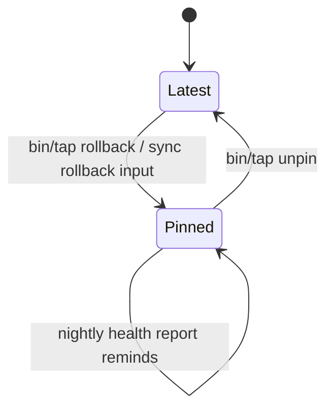

# Roll back a release

A tool's new release is broken for its users: serve the previous one again
until a fix is out. The old release goes through the same checks as a new
one (checksums, provenance, real installs) before it is published.

## From GitHub (no clone)

1. **Actions** → **sync** → **Run workflow**.
2. **rollback**: the tool's name in `tools.yml` (for example `kiwa`).
3. **Run workflow**.

sync pins the tool to its previous stable release (`pin:` in `tools.yml`),
tests it, and commits `⏪ revert(kiwa): back to 0.1.0`.

## From a clone

```sh
bin/tap rollback kiwa     # writes pin: "0.1.0" under kiwa in tools.yml
bin/tap sync              # downloads and verifies 0.1.0, rewrites the files
rake                      # tests + drift check
git commit -am "⏪ revert(kiwa): back to 0.1.0" && git push
```

## When the fix is out

```sh
bin/tap unpin kiwa
git commit -am "📌 build(kiwa): follow the latest release again" && git push
```

The next sync serves the latest release. Until then, the nightly health
report lists every pinned tool in the **Tap health report** issue, so a pin
is not forgotten.


