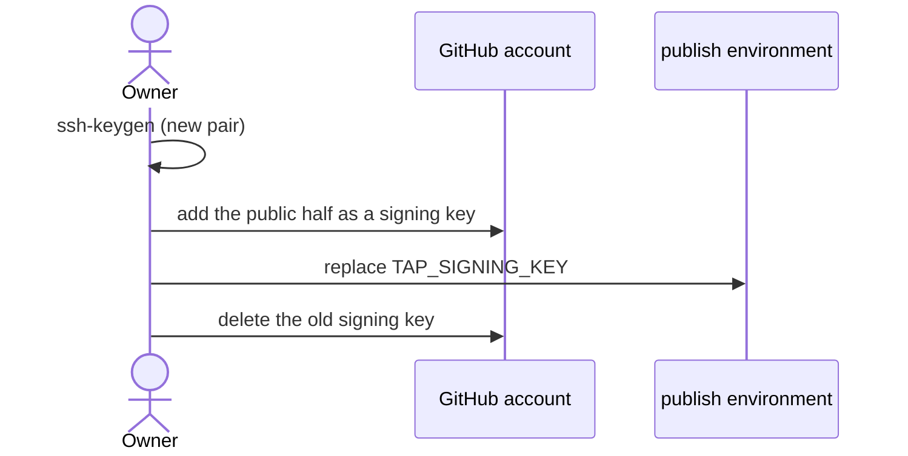

# Rotate the tap's secrets

The tap holds two secrets. `secrets.yml` checks both on the 1st of every
month and opens the issue **Secret rotation due** when one needs attention.

| Secret | Environment | What it does | Rotate |
| --- | --- | --- | --- |
| `TAP_SIGNING_KEY` | `publish` | Signs sync's commits as the owner | Yearly |
| `WINGET_TOKEN` | `winget` | Opens WinGet pull requests from the owner's fork | 30 days before it expires |

## `TAP_SIGNING_KEY`



1. Make the new pair. The passphrase must be empty (CI signs without a
   prompt). In PowerShell, go through `cmd` so the empty argument survives:

   ```sh
   ssh-keygen -t ed25519 -N "" -C "homebrew-tap CI signing" -f tap_signing
   ```

2. Register the public half as a **signing** key, with the same title
   (secrets.yml finds it by title):

   ```sh
   gh auth refresh -h github.com -s admin:ssh_signing_key
   gh ssh-key add tap_signing.pub --type signing --title "homebrew-tap CI signing"
   ```

   or <https://github.com/settings/ssh/new>, *Key type*: **Signing Key**.

3. Replace the secret, then delete both files:

   ```sh
   gh secret set TAP_SIGNING_KEY --env publish -R GregoireF/homebrew-tap < tap_signing
   rm tap_signing tap_signing.pub
   ```

4. Delete the old key: `gh ssh-key list`, then `gh ssh-key delete <id>`.
   Commits it signed stay Verified: GitHub records the verification when a
   commit is pushed.

5. Run **secrets** from the Actions tab: the issue closes.

## `WINGET_TOKEN`

1. Create a token at <https://github.com/settings/tokens/new?scopes=public_repo&description=homebrew-tap%20WINGET_TOKEN>
   (classic, scope `public_repo`, expiry one year).
2. `gh secret set WINGET_TOKEN --env winget -R GregoireF/homebrew-tap`, paste it.
3. Revoke the old token on the same page.
4. Run **secrets** from the Actions tab: the issue closes.
