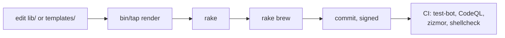

# Work on the tap

What you need to change the generator, the templates or the workflows, and
check your change before CI does.

## Set up

- Ruby 3.4 (standard library only: nothing to install with gem or bundle)
- Docker, for `rake brew`, shellcheck and the end-to-end scripts
- `git config core.hooksPath .githooks` once per clone: `rake` before each
  commit, the header format in `commit-msg`

## The loop

```sh
rake                 # tests (coverage floor 90%) + bin/tap check
rake brew            # brew style + audit --strict, current and latest Homebrew
bin/tap render       # after changing tools.yml, templates/ or lib/tap/targets/
UPDATE_GOLDEN=1 rake test   # after an intended change of a generated file's shape
```



## Checks outside Ruby

| What | Command |
| --- | --- |
| Workflows | `docker run --rm -v "$PWD:/repo" -w /repo rhysd/actionlint:1.7.12` and `ghcr.io/zizmorcore/zizmor --offline .` |
| Shell scripts | `bin/tap site _site`, then `koalaman/shellcheck:v0.11.0 --shell=sh _site/install.sh test/*.sh` |
| install.sh end to end | `sh test/installer.sh _site/install.sh` (Linux, macOS, Alpine) |
| aqua registry | `sh test/aqua.sh` (needs aqua) |
| Nix flake | `nix flake check --all-systems --no-build path:$PWD` |
| WinGet manifests | `winget validate --manifest winget/manifests/g/GregoireF/<tool>/<version>` |

## Add a package manager

One module under `lib/tap/targets/` with `files(catalog)` and `GLOBS`, its
name in `Targets.repository` (committed) or `Targets.site` (Pages only), a
test, and a job in `install-test.yml` that installs from it for real. See
[ADR-0006](../adr/0006-targets-as-plugins.md).

## Commits

`✨ feat(scope): subject`: gitmoji, Conventional Commits type, at most 72
characters. One subject per commit; signed; no co-author trailer
([AGENTS.md](../../AGENTS.md)).
