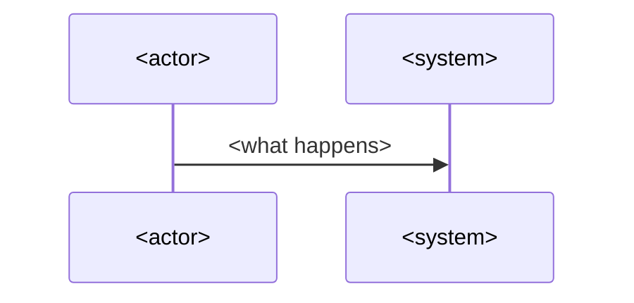

# <Topic>

<!-- Explanation (Diátaxis): why things are the way they are. Context,
trade-offs, alternatives; no step-by-step. Prefer one diagram that shows
the mechanism over prose that describes it. Delete these comments. -->

<The question this page answers, in one or two sentences.>

## <Aspect>

<Reasoning, with links to the ADRs that record each decision.>

| <Option> | <Trade-off> |
| --- | --- |
| <…> | <…> |
