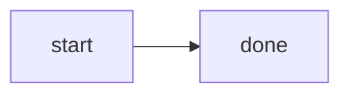

# <Verb> <object>

<!-- How-to (Diátaxis): a goal the reader already has. Title is the task
("Roll back a release"). No teaching, no background: link to explanation/.
Delete these comments. -->

<One sentence: when you need this and what you end with.>

## <The usual way>

1. <Action, imperative, one per step.>
2. <Action.>

```sh
<the exact command>
```

<What you see when it worked, if not obvious.>

## <A variant, if there is one>

<Same shape.>


